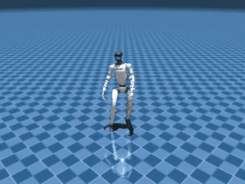

# G1 双视角舞蹈 PPO

本项目将 AIST++ 同一段舞蹈的 c01/c03 双视角视频转换为 Unitree G1 参考动作，并使用平衡残差 PPO 完成 100,000 次训练迭代。



## 最终结果

| 指标 | 结果 |
| --- | ---: |
| 最佳检查点 | `results/policy.pt` |
| 最佳迭代 | 97,805 |
| 评估平均回报 | 0.7157 |
| 完整跟踪 | 11.98 s |
| 跌倒 | 否 |
| 最大根节点 XY 误差 | 0.242 m |
| 最终根节点 XY 误差 | 0.149 m |
| 最终接触匹配 | 1.0 |
| 策略参数量 | 109,944 |

本地重新执行完整物理回放，策略完成 599 个控制步且未跌倒。第 100,000 轮保存的 `latest.pt` 在最终评估中跌倒，推理应使用 `policy.pt`。

## 项目流程

```text
AIST++ c01 + c03 双视角视频
  → MediaPipe 33 关键点
  → 标定相机 DLT 三角化
  → 时空洞修正
  → G1 全身 IK 重定向
  → 30 Hz reference.npz
  → 平衡残差 PPO
  → policy.pt
  → MuJoCo 物理回放
```

原始动作编号：

```text
gWA_sBM_cAll_d25_mWA0_ch01
```

训练包使用：

| 视角 | 文件 |
| --- | --- |
| c01 / A | `gWA_sBM_c01_d25_mWA0_ch01.mp4` |
| c03 / B | `gWA_sBM_c03_d25_mWA0_ch01.mp4` |

两段视频均为 1920×1080、59.94 FPS、719 帧。

## 目录

```text
code/                 MediaPipe、DLT、重定向、PPO 和 MuJoCo 代码
assets/               Unitree G1 MuJoCo 资产和腿部平衡先验
config/               AutoDL 环境配置
profiles/             不同 GPU 的训练参数
data/dance/           动作清单、双视角质量报告和许可说明
results/              最佳策略、评估、回放和验证摘要
train_auto.sh         自动配置环境并启动训练
train_dance_gpu.sh    直接 GPU 训练
verify_package.sh     训练包自检
```

## 下载

完整训练记录和最佳策略轻量包作为本机下载资源提供：

- `PPO_Training_Results_20261120_Final.tar.gz`
  - 100,000 行训练指标
  - 20,001 次评估记录
  - 自检日志和完整训练日志
  - 最佳与最新检查点
  - 实际策略回放
- `PPO_Best_Policy_20261120_Final.zip`
  - 最佳策略
  - 参考动作
  - 最佳评估
  - 验证摘要
  - MP4 回放

本机下载页：

```text
http://127.0.0.1:8766/result/
```

下载地址：

```text
http://127.0.0.1:8766/result/PPO_Training_Results_20261120_Final.tar.gz
http://127.0.0.1:8766/result/PPO_Best_Policy_20261120_Final.zip
```

GitHub Release 地址将在完成仓库认证与上传后补充。

## 快速验证

```bash
python verify_ppo_result.py
```

完整训练需要 AutoDL 或兼容 Linux CUDA 环境：

```bash
bash install_autodl.sh
bash verify_package.sh
bash smoke_test.sh
bash train_auto.sh
```

## 结果文件

- [详细结果说明](results/详细结果说明.md)
- [机器可读验证摘要](results/verification_summary.json)
- [最佳评估](results/best.json)
- [实际策略回放](results/policy_replay.mp4)
- [回放中间帧](results/policy_replay_poster.png)
- [本地回放评估](results/local_replay_validation/evaluation.json)

## 使用边界

- 训练曲线存在明显波动，最佳检查点按完整动作率、步数和回报综合选择。
- 180/360 参考帧中有 129 帧被标记为 rejected，IK 最大残差为 0.5132。
- 解压训练环境生成的 XML 使用 AutoDL 绝对 `meshdir`，跨机器加载时需要改为本地 G1 资产路径。
- 结果是仿真训练验证，不等同于实物机器人 sim-to-real 验证。
- 原始视频、相机标定和派生动作来自 AIST++，受 AIST Dance DB 研究许可约束。

## 第三方来源

- [AIST Dance Database](https://aistdancedb.ongaaccel.jp/)
- [AIST Dance DB 使用条款](https://aistdancedb.ongaaccel.jp/terms_of_use/)
- [AutoDL](https://www.autodl.com/)

原始视频和受许可约束的数据不包含在公开 Git 历史中，详见 [THIRD_PARTY_NOTICES.md](THIRD_PARTY_NOTICES.md)。
