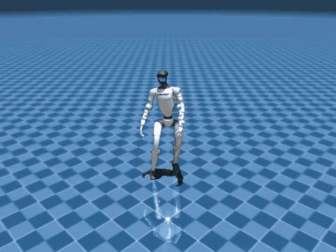

# G1 双视角舞蹈 PPO 训练结果

更新日期：2026-11-20

## 项目概述

本项目使用 AIST++ 同一段舞蹈的 c01、c03 双视角视频，经过 MediaPipe 姿态提取、DLT 三角化、短时空洞修正和 G1 全身重定向，生成 30 Hz 参考动作，再使用平衡残差 PPO 训练 Unitree G1 全身跟踪策略。

训练共完成 100,000 次 PPO 迭代、153,600,000 个并行环境步，AutoDL RTX 5090 上的实际耗时为 157 小时 52 分 46 秒。

## 原始视频

动作编号：

```text
gWA_sBM_cAll_d25_mWA0_ch01
```

| 视角 | 原视频 | 规格 |
| --- | --- | --- |
| c01 / A | `data/dance/a/gWA_sBM_c01_d25_mWA0_ch01.mp4` | 1920×1080，59.94 FPS，719 帧 |
| c03 / B | `data/dance/b/gWA_sBM_c03_d25_mWA0_ch01.mp4` | 1920×1080，59.94 FPS，719 帧 |

本地双视角视频：

- [c01 原视频](E:/TEST_RECORD/Server_Deploy/AutoDL/AutoDL_Dance_PPO_Package/data/dance/a/gWA_sBM_c01_d25_mWA0_ch01.mp4)
- [c03 原视频](E:/TEST_RECORD/Server_Deploy/AutoDL/AutoDL_Dance_PPO_Package/data/dance/b/gWA_sBM_c03_d25_mWA0_ch01.mp4)

参考动作：

- [reference.npz](E:/TEST_RECORD/Server_Deploy/AutoDL/result/gwa_ppo_results_20261107_162644/reference.npz)
- 360 帧，30 Hz，11.97 秒
- `contact_grounded_support_refined` 根轨迹

## 最佳策略

推理和展示应使用第 97,805 次迭代保存的 [policy.pt](E:/TEST_RECORD/Server_Deploy/AutoDL/result/gwa_ppo_results_20261107_162644/policy.pt)，而不是第 100,000 次迭代的续训状态 `latest.pt`。

| 指标 | 结果 |
| --- | ---: |
| 评估平均回报 | 0.7157 |
| 跟踪完成 | 是 |
| 是否跌倒 | 否 |
| 仿真时长 | 11.98 s |
| 最大根节点 XY 误差 | 0.242 m |
| 最终根节点 XY 误差 | 0.149 m |
| 最终接触匹配 | 1.0 |
| 关节辅助 | 启用 |
| 策略参数量 | 109,944 |

本地重新执行完整物理回放，结果为：

- 完成 599 个控制步，11.98 秒
- 平均回报 0.7139
- 未跌倒
- 最大根节点 XY 误差 0.280 m
- 最终双脚接触匹配 1.0

## 实际效果

- [最佳策略 MP4 回放](E:/TEST_RECORD/Server_Deploy/AutoDL/result/gwa_ppo_results_20261107_162644/policy_replay.mp4)
- [最佳策略 GIF 回放](E:/TEST_RECORD/Server_Deploy/AutoDL/result/gwa_ppo_results_20261107_162644/policy_replay.gif)
- [回放中间帧](E:/TEST_RECORD/Server_Deploy/AutoDL/result/gwa_ppo_results_20261107_162644/policy_replay_poster.png)
- [本地物理回放评估](E:/TEST_RECORD/Server_Deploy/AutoDL/result/gwa_ppo_results_20261107_162644/local_replay_validation/evaluation.json)
- [完整逐帧轨迹](E:/TEST_RECORD/Server_Deploy/AutoDL/result/gwa_ppo_results_20261107_162644/local_replay_validation/trajectory.json)



## 训练解析

`metrics.jsonl` 共 100,000 行，迭代从 1 到 100,000 严格递增，没有无效 JSON。训练过程中共记录 20,001 次独立评估，完整动作率为 56.98%；最后 10,000 轮完整动作率提升到 69.77%。

训练曲线整体存在明显波动，最佳检查点由“完整动作优先、再比较步数和回报”的规则选择。第 97,805 轮取得最高质量评估，之后最新权重发生退化，因此不能用迭代号更晚的 `latest.pt` 替代最佳策略。

- [训练指标](E:/TEST_RECORD/Server_Deploy/AutoDL/result/gwa_ppo_results_20261107_162644/metrics.jsonl)
- [最佳评估](E:/TEST_RECORD/Server_Deploy/AutoDL/result/gwa_ppo_results_20261107_162644/best.json)
- [基线评估](E:/TEST_RECORD/Server_Deploy/AutoDL/result/gwa_ppo_results_20261107_162644/baseline.json)
- [自检记录](E:/TEST_RECORD/Server_Deploy/AutoDL/result/gwa_ppo_results_20261107_162644/self_checks.jsonl)
- [训练日志](E:/TEST_RECORD/Server_Deploy/AutoDL/result/gwa_ppo_results_20261107_162644/train_20261101_014921.log)

## 完整性与限制

- 下载压缩包 SHA-256 与随包校验文件一致。
- 归档解压返回码为 0，53 个条目，无路径穿越。
- `policy.pt` 和 `latest.pt` 均为有限数值，结构可正常加载。
- 本地使用最佳权重完成完整物理回放，策略实际参与控制。
- 参考动作 360 帧中有 129 帧被标记为 rejected，IK 误差均值为 0.0655、最大值为 0.5132；引用轨迹质量时需要说明这一限制。
- 解压归档中的 `robot.xml` 写入了 AutoDL 绝对 `meshdir`，直接在其他机器加载前需要改为本地 MuJoCo 资产目录。
- 原始视频、标定和派生动作受 AIST Dance DB 研究许可约束，不应超出原许可范围再分发。

机器可读验证结果：

- [verification_summary.json](E:/TEST_RECORD/Server_Deploy/AutoDL/result/gwa_ppo_results_20261107_162644/verification_summary.json)

## 下载方式

完整训练记录：

```text
http://127.0.0.1:8766/result/PPO_Training_Results_20261120_Final.tar.gz
```

最佳策略轻量包：

```text
http://127.0.0.1:8766/result/PPO_Best_Policy_20261120_Final.zip
```

本地下载页：

```text
http://127.0.0.1:8766/result/
```

本机文件：

- [完整训练记录](E:/TEST_RECORD/Server_Deploy/AutoDL/result/PPO_Training_Results_20261120_Final.tar.gz)
- [最佳策略轻量包](E:/TEST_RECORD/Server_Deploy/AutoDL/result/PPO_Best_Policy_20261120_Final.zip)

## 官方来源

- AIST Dance Database：[https://aistdancedb.ongaaccel.jp/](https://aistdancedb.ongaaccel.jp/)
- AIST Dance DB 使用条款：[https://aistdancedb.ongaaccel.jp/terms_of_use/](https://aistdancedb.ongaaccel.jp/terms_of_use/)
- AutoDL：[https://www.autodl.com/](https://www.autodl.com/)

训练代码、最佳策略、派生动作、验证结果和实际回放已发布到公开 GitHub 仓库。AIST++ 原始双视角视频与相机标定未包含在仓库中，仍需遵守 AIST Dance DB 研究许可。
